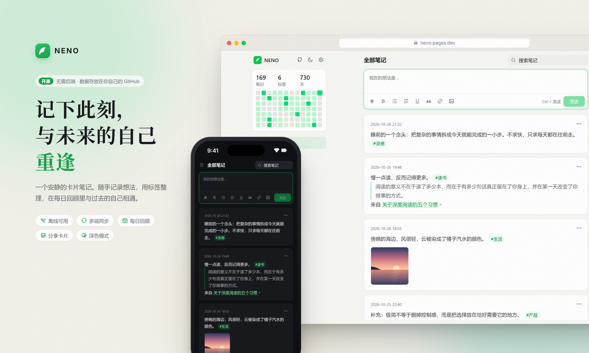
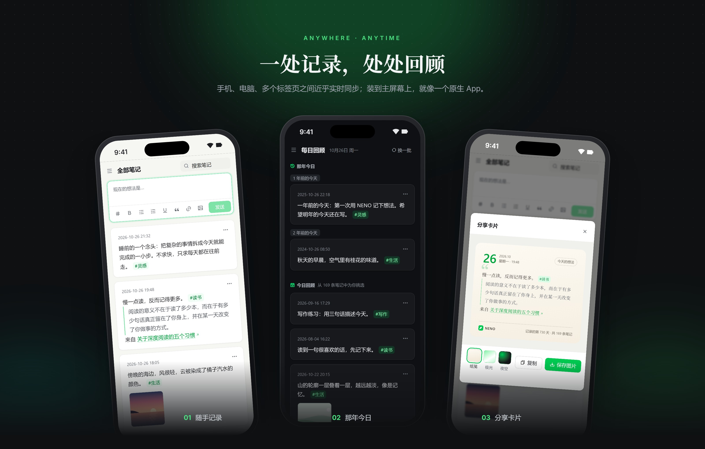
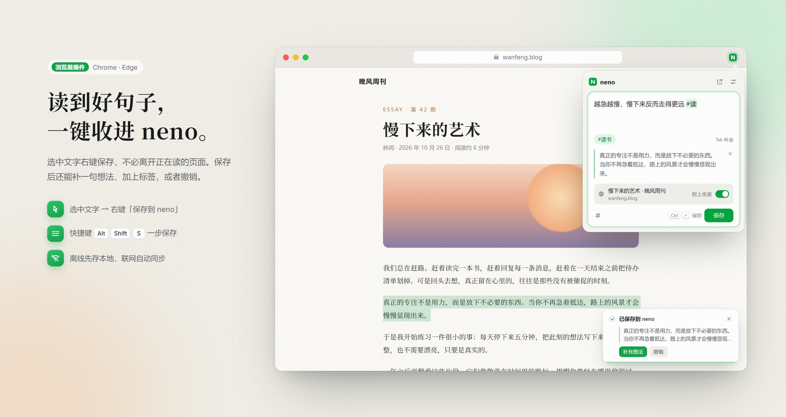

<p align="center">
  
</p>

<h1 align="center">NENO</h1>

<p align="center">
  一个开源的卡片笔记应用, 灵感来自 <a href="https://flomoapp.com/">浮墨</a>。<br />
  不需要后端, 所有文字和图片都保存在你自己的 GitHub 仓库里。
</p>

<p align="center">
  <a href="https://neno.pages.dev/"><b>立即体验</b></a> ·
  <a href="https://github.com/openneno/neno-chrome-plugin">浏览器插件</a> ·
  <a href="#自己部署">自己部署</a>
</p>

---

## 特点

- **数据属于你**: 笔记以 JSON 文件保存在你自己的 GitHub 私有仓库中, 随时可以导出、迁移或用其他工具读取
- **离线可用**: 基于浏览器本地数据库的 PWA, 断网也能记录和浏览, 联网后自动同步
- **多设备同步**: 多台设备、多个标签页之间近乎实时同步, 同一条笔记两端都修改时保留较新的一份
- **一个 Token 完成设置**: 引导式同步设置, 可以新建私有仓库; 其他设备扫码或打开同步链接即可导入配置
- **记录**: 富文本编辑(加粗、列表、引用、链接), `#标签` 自动补全, 标签可以换成 emoji 图标, 粘贴或上传图片, 对笔记进行批注
- **回顾**: 每日回顾、那年今天、随机漫步, 按日期、标签和关键词检索
- **分享**: 把笔记生成精美的图片卡片, 提供纸笺、极光、夜空三种模板
- **外观**: 浅色 / 深色 / 跟随系统, 6 种主题色, 适配手机和电脑
- **备份**: 完整导出所有笔记和图片, 也可以从备份恢复
- **Notion 同步**: 通过 GitHub Action 把笔记同步到 Notion

<p align="center">
  
</p>

## 开始使用

1. 打开 [neno.pages.dev](https://neno.pages.dev/), 进入 **设置 → 同步**
2. 按照引导生成一个 GitHub Token(已预选所需权限)并粘贴
3. 选择一个已有仓库, 或让 NENO 新建一个私有仓库 `neno-data`

在其他设备上, 扫描设置页中的二维码或打开同步链接即可完成配置。

> 二维码、同步链接和 neno token 中包含你的 GitHub Token, 请不要分享给他人。

## 扩展工具

<p align="center">
  
</p>

在 **设置 → 同步** 中点击「复制 neno token」, 即可在以下工具中使用同一个笔记仓库:

| 工具 | 说明 |
| --- | --- |
| [浏览器插件](https://github.com/openneno/neno-chrome-plugin) | 选中网页文字右键保存、快捷键速记, 保存后可补充想法或撤销 |
| [neno-cli](https://github.com/openneno/neno-cli) | 在命令行中记录笔记 |
| [Telegram Bot](https://github.com/openneno/neno-tg) | 通过 [neno Bot](https://t.me/NenoTG_Bot) 发送笔记 |
| [微信公众号](https://github.com/Mran/neno-wx) | 通过公众号消息记录笔记 |
| [uTools 插件](https://github.com/Mran/neno-extension) | 在 [uTools](https://u.tools/) 中搜索 neno 插件 |

## 数据格式

笔记仓库的结构很简单, 便于其他工具读写:

```
YYYY-MM-DD/<笔记 id>.json   一条笔记
picData/<图片 id>.<后缀>     一张图片
pinTags/pinTags.json        标签设置(置顶标签、标签图标)
```

每条笔记是一个 JSON 文件:

```json
{
  "_id": "6adecb5eebcd69e38944057d",
  "content": "<p>笔记的 HTML 内容 #标签</p>",
  "pureContent": "笔记的纯文本 #标签",
  "tags": ["#标签"],
  "images": [],
  "parentId": "",
  "source": "web",
  "created_at": "2026-10-26T11:39:10+08:00",
  "update_at": "2026-10-26T11:39:10+08:00"
}
```

标签设置文件中, `tags` 是置顶的标签; `icons` 是可选的标签图标, 没有设置图标时不会出现:

```json
{
  "_id": "pinTags",
  "created_at": "pinTags",
  "tags": ["#灵感", "#读书"],
  "icons": {"#读书": "📚", "#工作": "💼"}
}
```

## 自己部署

NENO 是纯前端应用, 构建后的静态文件可以部署到任意静态托管服务。

```bash
bun install      # 或 npm install
bun run dev      # 本地开发
bun run build    # 构建, 输出到 dist/
```

也可以一键部署到 Vercel:

[](https://vercel.com/new/git/external?repository-url=https%3A%2F%2Fgithub.com%2Fopenneno%2Fneno)

自己部署后, 可以在浏览器插件的设置中把「neno 网页地址」改为你的地址。

## 技术栈

[Svelte](https://svelte.dev/) · [Tailwind CSS](https://tailwindcss.com/) · [Vite](https://vite.dev/) · [Quill](https://quilljs.com/) · IndexedDB · GitHub REST / GraphQL API

## License

[GPL-3.0](LICENSE.md)
